# Embedded Claims Audit

**Conventions, not constants.** A reproducible audit of 22 quantitative claims from motor-drive and embedded-systems education: ten experiments, one artifact path per number, and a live console you can operate.

[](https://github.com/M0-AR/embedded-claims-audit/actions/workflows/ci.yml)
[](https://github.com/M0-AR/embedded-claims-audit/releases)
[](LICENSE)
[](pyproject.toml)
[](https://www.kaggle.com/datasets/wkirgsn/electric-motor-temperature)
[](https://m0-ar.github.io/embedded-claims-audit/preview.html)

[Live console](https://m0-ar.github.io/embedded-claims-audit/preview.html) · [The paper](#abstract) · [Claim registry](https://m0-ar.github.io/embedded-claims-audit/demo/app.html#/claims) · [Results](results/results.json) · [Releases](https://github.com/M0-AR/embedded-claims-audit/releases) · [Container](https://github.com/M0-AR/embedded-claims-audit/pkgs/container/embedded-claims-audit)

<p align="center">
  <a href="https://m0-ar.github.io/embedded-claims-audit/preview.html">
    
  </a>
</p>
<p align="center"><sub>The console is the artifact: every verdict opens a path into <code>results/results.json</code>.</sub></p>

## Executive summary

**For a decision-maker:** engineering teams copy numbers out of videos, datasheets, and application notes faster than they copy the conditions attached to those numbers. This repository turns 22 such claims into executable evidence. Each claim is stored with its formula, convention, operating point, hidden load, observed value, and a verdict. The result is a reusable teaching artifact and a review checklist, not a criticism of individual creators.

- **The problem.** A number without its denominator, unit convention, operating point, or hidden load is not a specification. It is a rumor with a decimal point.
- **The artifact.** 22 claims (C01–C22), ten independent experiments (E1–E10), a claim registry, a generated paper, an interactive console with six labs, and a 3D concept game.
- **The evidence.** 10 claims are supported as stated, 5 are qualified, and 7 are refuted. `make verify` re-runs the experiments and compares 34,650 scalar fields with a maximum relative difference of 0.0e+00.
- **The pattern.** The failures cluster into normalization, convention, hidden loading, model-derived data, and arithmetic artifacts. The same five questions expose all five.
- **The reusable object.** Store the claim tuple — formula, convention, operating point, hidden load, evidence class — not just the formula.

| Question | Short answer |
|---|---|
| What is being audited? | 22 quantitative claims from a twenty-video corpus on motor drives, inverters, sensing, embedded buses, PCB design, and a production inverter teardown. |
| Is it reproducible? | Yes. `make verify` re-runs all experiments against the stored JSON artifact, field by field. |
| Can I try it without installing? | Yes. The [live console](https://m0-ar.github.io/embedded-claims-audit/preview.html) runs the real application in your browser. |
| Do I need the 300 MB dataset? | No for E1–E9. E10 uses the public Paderborn dataset and is skipped cleanly when the CSV is absent. |
| Can I reuse it? | Code is MIT; the dataset is CC BY-SA 4.0. Cite with [`CITATION.cff`](CITATION.cff). |

## 🌱 Beginner guide — read this and you are a professional

You do not need a motor-drive course to use this repository. Start with one sentence, not ten. By the end of this guide you can read a quantitative claim, name the condition it hides, and check the evidence yourself. You will know more than most interview candidates.

**Step 1 — Read the sentence literally.** A claim is a sentence with a number in it. “A 4.7 kΩ pull-up is fine for I2C” contains a component value, a bus, and an implied “always”. The word “fine” is doing unpaid work.

**Step 2 — Ask what the number is normalized to.** Peak or mean? Line-line or phase? Per phase or total? A 120-degree six-step drive has 13.4% ripple of peak and 14.0% of mean. Both are correct; they answer different questions. If the claim does not say which denominator it used, it has not finished making the claim.

**Step 3 — Ask which convention is in force.** K_t = 9.5493/K_v is a DC/120-degree conversion. A field-oriented drive uses a different convention, which is why the same motor can appear as 0.0306 N·m/A in one table and 0.0354 N·m/A in another. Neither vendor is lying. The sentence dropped the convention.

**Step 4 — Ask where the operating point sits.** “The 4.7 kΩ pull-up is a 100 kHz component” is a statement about rise time, bus capacitance, and sink current. At 400 pF the Fast-mode window can close completely. At a smaller capacitance the same resistor is ordinary. A number that holds only at m → 0 is a limit, not a design rule.

**Step 5 — Ask what load is hidden.** A 680 Ω RS-485 failsafe bias can pass an unloaded calculation and fail with 32 unit loads attached. The receiver input resistance is not a detail; it is part of the circuit. The same pattern appears in PCB traces, where the current and the allowed temperature rise are the hidden load.

**Step 6 — Check the evidence path.** Every claim in this repository points at a key in `results/results.json`. Open the claim drawer in the console, or read the path in [`claims/claims.yaml`](claims/claims.yaml), then inspect the value. You are not asked to trust the prose.

Let's work this out in a step-by-step way to be sure we have the right answer.

Take C01: “A 120-degree six-step drive with sinusoidal back-EMF has about 13.4% torque ripple.”

1. The measured quantity is torque ripple.
2. The denominator is not stated. The exact value is 13.3975% of peak or 14.0298% of mean.
3. The hidden conditions are a sinusoidal back-EMF, ideal 120-degree current blocks, and aligned commutation.
4. The evidence path is `e01_sixstep.cases.sine_emf_120_blocks.pct_of_peak`.
5. The verdict is **supported** because 13.4% is the peak-normalized value and the stated conditions match.
6. The claim would move if the EMF were trapezoidal or the commutation were misaligned. At 15 electrical degrees, the same drive reaches 29.29%.

Now try C12 yourself: “Fast-mode I2C at 400 pF and 3.3 V is feasible.” Ask the questions above, then open [the claim registry](https://m0-ar.github.io/embedded-claims-audit/demo/app.html#/claims). The short answer is that the minimum pull-up resistance exceeds the maximum, so the window is empty. The verdict is **refuted** — not because the formula is wrong, but because the operating point was left out.

**The five questions to ask any number:** What is the denominator? Which convention? Which operating point? What hidden load? What evidence class? If a claim survives all five, it is a specification. If not, it is a starting point for one.

## What you can do with it

- **Students** can learn the difference between a formula and a specification. The beginner guide, the six labs, and the 3D mission all use the same claim registry.
- **Instructors** can adopt the claim table, the figures, and the labs as a ready-made lesson on assumptions and operating points.
- **Reviewers** can use the five-question checklist on a design review, a datasheet comparison, or an application note.
- **Engineers** can reproduce the numbers, change an operating point, and see which conclusions move.
- **Tool builders** can reuse the artifact model: one JSON path per published number, one command that proves the prose still matches the code.

## Features

- **Claim registry (C01–C22)** with observed value, claimed value, verdict, and an artifact path for every entry.
- **Ten executable experiments** combining closed-form identities, switching-level simulation, commercial datasheets, and a real PMSM dataset.
- **Verification contract.** `make verify` re-runs the experiments and compares 34,650 scalar fields; a mismatch exits non-zero.
- **Interactive console** with the claim registry, experiment cards, six calculators, a quiz, keyboard navigation, and a printable field guide.
- **3D concept game.** Six missions tie a virtual PMSM drive and a 22-node claim network to the audit.
- **Static and offline-friendly.** The console vendors its 3D runtime; no account, server, or network call is required after checkout.
- **Reproducible paper.** `README.md` is generated from `paper/paper.md.j2` and `results/results.json`; numbers are resolved by path, not typed by hand.
- **Release engineering.** Tagged GitHub Releases, Python wheel and sdist, a GHCR container, CI, and GitHub Pages.

## Screenshots

| Audit overview | Claim registry |
|---|---|
| [](https://m0-ar.github.io/embedded-claims-audit/demo/app.html#/overview) | [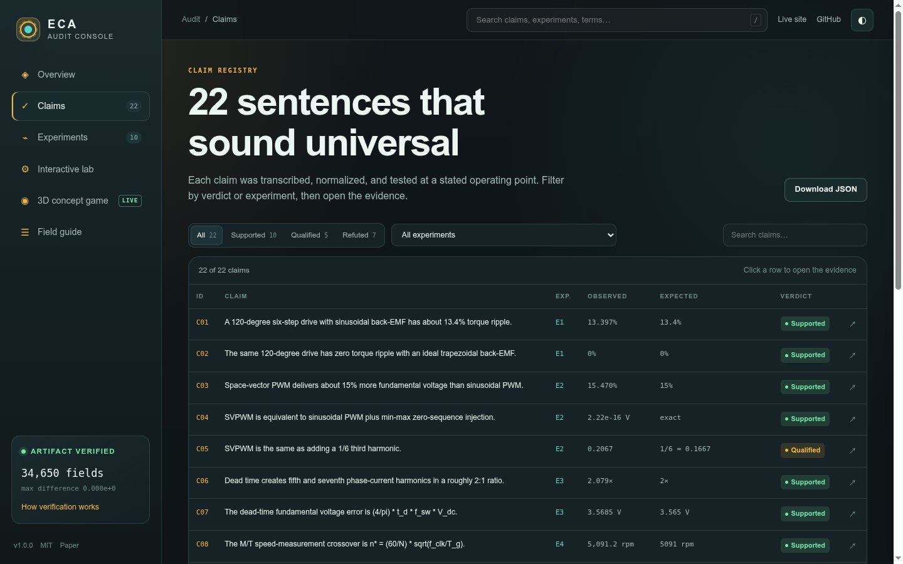](https://m0-ar.github.io/embedded-claims-audit/demo/app.html#/claims) |
| **Interactive lab** | **3D concept mission** |
| [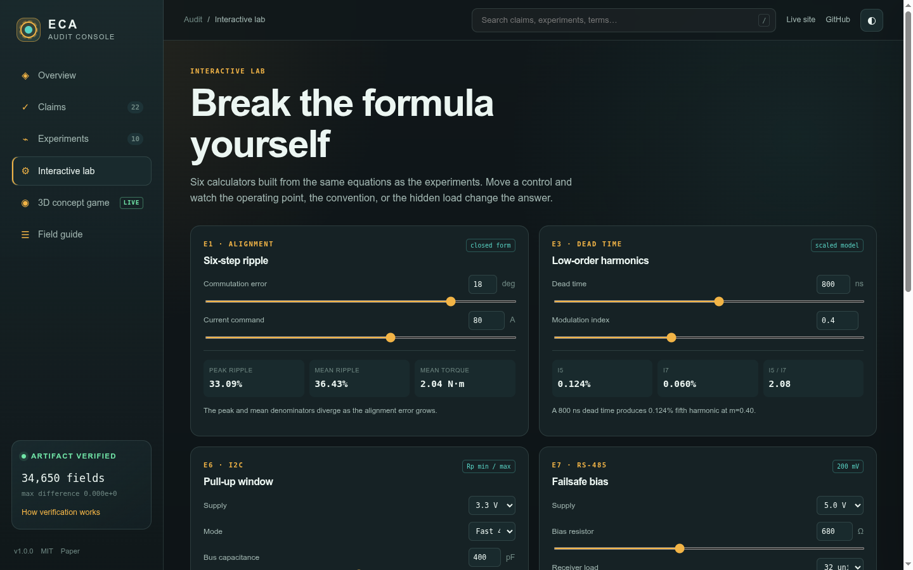](https://m0-ar.github.io/embedded-claims-audit/demo/app.html#/lab) | [](https://m0-ar.github.io/embedded-claims-audit/demo/app.html#/game) |

## Quickstart

```bash
git clone https://github.com/M0-AR/embedded-claims-audit.git
cd embedded-claims-audit
python -m venv .venv
. .venv/bin/activate
pip install -e ".[dev]"

make test          # unit tests for the analytic identities and simulations
make experiments   # regenerate results/*.json
make verify        # re-run and compare every stored field
python3 -m http.server 8000
```

Open <http://localhost:8000/preview.html> for the live preview, or <http://localhost:8000/demo/app.html> for the console directly. E1–E9 run without external data. E10 needs the Paderborn CSV:

```bash
python scripts/download_data.py   # prints or runs the Kaggle download
make paper                        # regenerate README.md and figures
```

The dataset is not redistributed. The expected SHA-256 and the Kaggle command are in [`scripts/download_data.py`](scripts/download_data.py).

## Releases, packages, and citation

- **GitHub Releases:** source archive, Python wheel, sdist, and `SHA256SUMS` for `v1.0.0` and later.
- **Python install from a tag:**

  ```bash
  pip install "embedded-claims-audit @ git+https://github.com/M0-AR/embedded-claims-audit.git@v1.0.0"
  ```

- **Container:**

  ```bash
  docker run --rm \
    -v "$PWD/results:/app/results" \
    ghcr.io/m0-ar/embedded-claims-audit:1.0.0 \
    make verify
  ```

- **Citation:** use [`CITATION.cff`](CITATION.cff) or the “Cite this repository” button on GitHub.
- **License:** MIT for code and prose. The Paderborn dataset remains CC BY-SA 4.0 and is not redistributed here.

## GitHub Pages

The site is a static deployment from the `main` branch root. There is no build step and no framework runtime.

- **Landing page:** <https://m0-ar.github.io/embedded-claims-audit/>
- **Live preview:** <https://m0-ar.github.io/embedded-claims-audit/preview.html>
- **Console:** <https://m0-ar.github.io/embedded-claims-audit/demo/app.html>
- **Why `.nojekyll`:** it tells Pages to serve the files as-is, including paths that begin with an underscore.

To publish a fork, open **Settings → Pages → Build and deployment**, choose **Deploy from a branch**, select `main` and `/ (root)`, and save. The landing page is `index.html`; `404.html` handles unknown paths.

## FAQ

**Is this peer reviewed?** No. It is a public, reproducible artifact with a verification command. The paper states its own limits.

**Did you measure hardware?** No. The evidence is closed-form analysis, switching-level simulation, commercial datasheets, and a public dataset. No oscilloscope was used.

**Why do some claims get “qualified” instead of “refuted”?** A qualified claim has a correct number under a condition the source omits. A refuted claim does not hold under the conditions the source implies. The distinction is the point of the audit.

**Why only 22 claims?** They were selected because they are quantitative, consequential, and testable with public evidence. The registry is deliberately small enough to inspect.

**Can I use it in a course?** Yes. The code and prose are MIT; the dataset is CC BY-SA 4.0. Attribution is appreciated.

**Does the console need a server?** No. It is static HTML, CSS, and JavaScript. Serve the repository root with any static file server, or open the Pages deployment.

**Why is the preview an iframe?** The real console owns its route, theme, saved game progress, and calculators. Loading it in an iframe keeps those behaviors intact instead of reimplementing a mock.

**How do I report a mistake?** Open an issue with the claim ID, the expected value, and the artifact path. A reproducible counterexample is the most useful report.

## Glossary

| Term | Meaning |
|---|---|
| **Claim tuple** | Formula, convention, operating point, hidden load, and evidence class. The reproducible object of this audit. |
| **Supported** | Holds as stated at a conventional operating point, within the precision of the sentence. |
| **Qualified** | Correct only under a convention or limiting condition the source omits. |
| **Refuted** | Does not hold under the conditions the source implies. |
| **Artifact path** | The key sequence into `results/results.json` that resolves a published number. |
| **Verification** | Re-running the experiments and comparing the fresh payload with the stored payload, field by field. |
| **SVPWM** | Space-vector PWM; the min-max zero-sequence construction reaches \(1/\sqrt{3}\) of the dc bus. |
| **Dead time** | The blanking interval between complementary switch commands; it creates a low-order voltage error. |
| **M/T methods** | Two speed-measurement approaches: counting pulses over a gate time, or timing the period between pulses. |
| **K_t / K_v** | Torque and voltage constants. Their ratio depends on the current and EMF conventions. |
| **I2C** | A two-wire bus whose pull-up window depends on rise time, bus capacitance, and sink current. |
| **RS-485** | A differential bus whose failsafe bias must include termination and receiver load. |
| **IPC-2221 / IPC-2152** | PCB current-capacity standards with different thermal assumptions and different answers. |
| **PMSM** | Permanent-magnet synchronous machine; the machine type in the E10 dataset. |
| **dq** | The rotor-oriented two-axis transform used in field-oriented control. |

## Repository map

| Path | Contents |
|---|---|
| [`claims/claims.yaml`](claims/claims.yaml) | The 22-claim registry and artifact paths. |
| [`src/eca/`](src/eca/) | The ten experiments, paper renderer, verification loop, and plotting code. |
| [`experiments/`](experiments/) | Standalone experiment entry points. |
| [`results/`](results/) | Generated JSON artifacts, verification summary, and figures. |
| [`demo/`](demo/) | The static audit console, vendored 3D runtime, and data bundle. |
| [`assets/`](assets/) | Screenshots, the social card, and the product tour. |
| [`paper/paper.md.j2`](paper/paper.md.j2) | The single source for this README and the paper. |
| [`tests/`](tests/) | Unit and artifact tests. |
| [`.github/workflows/`](.github/workflows/) | CI, release, and container workflows. |

---

# Conventions, Not Constants: A Reproducible Audit of Quantitative Claims in Practical Motor-Drive and Embedded-Systems Education

**Embedded Claims Audit Project**  
Version 1.0.0 — generated 2026-11-17T19:23:47+00:00 from `results/results.json`

---

## Abstract

Practical engineering education compresses. A twenty-minute video can contain a hundred numbers, each carrying an implicit denominator, unit convention, operating point, and hidden load. The formulas are often correct; the qualifiers are what disappear. This paper treats a twenty-video corpus on motor drives and embedded systems as a set of testable quantitative claims and audits 22 of them with ten independent experiments. The experiments combine closed-form identities, switching-level simulation, commercial datasheets, and a 185-hour public permanent-magnet synchronous machine (PMSM) dataset. Of the 22 claims, 10 are supported as stated, 5 are qualified (the number is right only under a condition the corpus omits), and 7 are refuted under the conditions the corpus implies. The failures cluster into five patterns: normalization (13.4% versus 14.0%), convention (K_t = 9.55/K_v versus 8.27/K_v), hidden loading (a 680 Ω RS-485 bias that passes unloaded and fails at 32 unit loads), model-derived data (a real torque channel that is not an independent torque measurement), and arithmetic artifacts (the IPC-2221 internal-layer 2.6× penalty is exactly what halving the current produces). The most useful result is not that a particular formula is wrong. It is that a claim is a tuple — formula, convention, operating point, and hidden load — and that the tuple, not the formula, is the reproducible object. All numbers in this paper are resolved from executed JSON artifacts, and `make verify` re-runs the experiments and compares them field by field.

**Keywords:** reproducibility; engineering education; motor drives; PMSM; space-vector PWM; dead time; I2C; RS-485; PCB thermal design; artifact evaluation.

---

## 1. Introduction

Engineering claims travel badly. A statement such as “K_t = 9.5493/K_v” is short enough to memorize and wrong often enough to matter. The formula is not wrong in its home convention: it is the DC/120-degree conversion between line-line back-EMF and peak phase current. It becomes wrong when a student applies it to a field-oriented drive whose datasheet specifies line-line peak voltage, or when a reviewer compares it with a vendor’s 0.031 Nm/A and concludes that one of the two is mistaken. The missing object is not a constant. It is the tuple of conventions under which the constant is defined.

This paper is an audit of that tuple. We take a corpus of twenty educational videos on BLDC/PMSM drives, three-phase inverters, Hall sensing, PWM, speed measurement, STM32 peripherals, I2C, RS-485, PCB layout, and the Tesla Model 3 inverter. We extract 22 quantitative claims that are specific enough to test, and we build ten experiments that test them against four kinds of evidence:

1. **Closed-form identities**, where the claim has an exact answer (six-step ripple, SVPWM headroom, dead-time voltage error, M/T crossover, K_t/Ke conversion, I2C rise time, RS-485 bias, IPC area scaling, H-bridge ripple).
2. **Switching-level simulation**, where the idealization itself is the question (dead-time harmonics, unipolar versus bipolar ripple and loss).
3. **Commercial datasheets**, where the claim’s convention can be inferred from a real part (the ODrive D5065 270 Kv motor, NXP UM10204, TI’s I2C and RS-485 guides).
4. **Real public data**, where the claim is about a physical machine (the Paderborn LEA PMSM temperature dataset: 1,330,816 samples, 69 profiles, 184.8 hours, 2 Hz).

The contributions are:

- A **claim registry** (C01–C22) that records each statement, its experiment, its observed value, its claimed value, and a three-level verdict: *supported*, *qualified*, or *refuted*.
- **Ten executable experiments** with a single artifact format. Every number in this paper is resolved by path from `results/results.json`; no result is typed by hand into the prose.
- A **verification loop**: `make verify` re-runs the experiments and compares the fresh payload with the stored payload within a stated tolerance.
- A **cross-cutting analysis** of why the failures cluster: normalization, convention, hidden loading, model-derived data, and arithmetic artifacts.
- A **real-data provenance audit** showing that a real dataset can be real and still not validate what it appears to validate.

The audit is not a critique of individual creators. Educational compression is rational: a video must choose one number, and the chosen number is usually the one that fits the board in front of the presenter. The audit is a critique of the compressed *form* — of treating a conditional number as a universal constant.

### 1.1 What this paper is not

It is not a random sample of engineering education. The claims were selected because they are quantitative, consequential, and testable with public evidence. It is not a hardware validation: the experiments are numerical, datasheet-based, or data-based, and no oscilloscope was used. It is not a claim that the creators intended the strong reading. The verdicts apply to the claims as stated, with the qualifiers the corpus supplies.

---

## 2. The corpus and the claims

The corpus covers six areas: (i) BLDC/PMSM commutation and torque ripple, (ii) three-phase inverter modulation and dead time, (iii) speed and position measurement, (iv) motor constants and field-oriented control, (v) embedded buses and PCB design, and (vi) a teardown of a production inverter. The claims were extracted in three passes:

1. **Transcription.** Every sentence with a number, a formula, or a comparative (“halves”, “twice”, “conservative”) was marked.
2. **Normalization.** We asked what the number is normalized to: peak or mean? line-line or phase? per phase or total? per switching period or per fundamental period?
3. **Operationalization.** We asked what operating point makes the claim true or false, and whether that point is stated. A claim that survives only at m → 0, or only unloaded, or only in Standard mode, is qualified rather than supported.

The resulting registry is in `claims/claims.yaml`. Table 1 is generated from it. The verdict taxonomy is deliberately coarse:

- **Supported**: the claim holds under the stated conditions at a conventional operating point, and the observed value agrees with the claimed value within the precision of the statement.
- **Qualified**: the number is correct in a stated convention or at a limiting operating point, but the corpus omits the condition. The claim is incomplete, not arithmetically wrong.
- **Refuted**: the claim does not hold under the conditions the corpus implies, or the stated generalization is false.

Table 1. The claim registry. Observed values are resolved from `results/results.json`; the final column is the verdict.

| ID | Claim | Exp. | Observed | Claimed / expected | Verdict |
|---|---|---|---|---|---|
| C01 | A 120-degree six-step drive with sinusoidal back-EMF has about 13.4% torque ripple. | E1 | 13.397% | 13.4% | supported |
| C02 | The same 120-degree drive has zero torque ripple with an ideal trapezoidal back-EMF. | E1 | 0% | 0% | supported |
| C03 | Space-vector PWM delivers about 15% more fundamental voltage than sinusoidal PWM. | E2 | 15.470% | 15% | supported |
| C04 | SVPWM is equivalent to sinusoidal PWM plus min-max zero-sequence injection. | E2 | 2.22e-16 V | exact | supported |
| C05 | SVPWM is the same as adding a 1/6 third harmonic. | E2 | 0.2067 | 1/6 = 0.1667 | qualified |
| C06 | Dead time creates fifth and seventh phase-current harmonics in a roughly 2:1 ratio. | E3 | 2.079× | 2× | supported |
| C07 | The dead-time fundamental voltage error is (4/pi) * t_d * f_sw * V_dc. | E3 | 3.5685 V | 3.565 V | supported |
| C08 | The M/T speed-measurement crossover is n* = (60/N) * sqrt(f_clk/T_g). | E4 | 5,091.2 rpm | 5091 rpm | supported |
| C09 | The T method is unusable at high speed because its error grows with n squared. | E4 | 659.7 rpm | ~660 rpm at 6007 rpm | supported |
| C10 | K_t = 9.5493/K_v is a universal conversion. | E5 | 0.03063 Nm/A | 0.03537 (9.5493/Kv) | qualified |
| C11 | A 4.7 kOhm pull-up is fine for I2C. | E6 | Standard-only | multi-mode | refuted |
| C12 | Fast-mode I2C at 400 pF and 3.3 V is feasible. | E6 | infeasible | feasible | refuted |
| C13 | Fast-mode Plus cannot drive 550 pF at 3.3 V. | E6 | feasible | infeasible | refuted |
| C14 | A 680 Ohm failsafe bias is sufficient for a 5 V RS-485 bus. | E7 | 183.2 mV | >= 200 mV | refuted |
| C15 | A 120 Ohm termination matches Cat5e. | E7 | 9.09% | 0% mismatch | qualified |
| C16 | IPC-2221 trace-width tables are conservative. | E8 | 2.114× | >= 1 (conservative) | refuted |
| C17 | IPC-2221 says internal traces need 2.6 times the area of external traces. | E8 | 2.601× | 2.6× | qualified |
| C18 | Unipolar PWM halves current ripple compared with bipolar PWM. | E9 | 0.750× | 0.5× | qualified |
| C19 | Unipolar PWM halves switching loss compared with bipolar PWM. | E9 | 0.500× | 0.5× | supported |
| C20 | The Paderborn torque channel is an independent measurement of electromagnetic torque. | E10 | 0.022%/K | -0.12 %/K (magnet trend) | refuted |
| C21 | The 1.5 factor in the dq power equation is an arbitrary convention. | E10 | 1.4238 | <= 1 | refuted |
| C22 | NdFeB magnets lose about 0.11-0.13% of remanence per kelvin. | E10 | -0.122%/K | -0.11 to -0.13 %/K | supported |

The distribution is 10 supported, 5 qualified, and 7 refuted. The split is not the point. The point is that the qualified and refuted cases are not random: they concentrate in claims where a convention or a load is invisible in the sentence.

---

## 3. Methodology

### 3.1 Artifact model

Each experiment is a Python module with a `run()` function that returns a JSON-serializable dictionary. `eca.run` calls all ten modules, writes one JSON file per experiment, and writes a combined `results/results.json` with an `environment` block (Python, NumPy, platform, UTC timestamp). `eca.paper` loads the combined file, resolves each claim’s `path` (for example `[e09_hbridge, schemes, 1, ripple_ratio_to_bipolar]`), applies an optional scale, and renders this document from `paper/paper.md.j2`. `eca.verify` re-runs the experiments and compares the fresh payload with the stored payload. The rule is simple: if a number appears in this paper, it has a path in the artifact.

This is a stronger discipline than “the code is available”. A reader can change a line of code, re-run, and see which sentences move. The claim table makes the dependency explicit: C18 points at the single-leg ripple ratio; C22 points at the q-axis magnet coefficient. A regression in either experiment changes the table, not just a figure.

### 3.2 Evidence classes

The experiments use four evidence classes, in increasing order of realism:

- **Exact identities.** E1, E2, E4, E5, E6, E7, E8, and the analytic parts of E9 have closed forms. The code computes the form and, where possible, checks it against a numerical construction (for example, E2 checks min-max injection against the dwell-time SVPWM construction, and E1 checks the sampled ripple against \(1-\sqrt{3}/2\)).
- **Switching-level simulation.** E3 and E9 integrate the phase equations at 200 ns (E3) or 25 ns (E9) steps. These are ideal-switch models: no device nonlinearity, no dead-time temperature dependence, no parasitic inductance. They answer “what does the topology do?”, not “what does a specific gate driver do?”.
- **Datasheet triangulation.** E5 uses the ODrive D5065 datasheet (K_v = 270 rpm/V, K_t = 0.031 Nm/A, seven pole pairs); E6 uses NXP UM10204 (rise times, bus capacitance, sink currents); E7 uses TI’s RS-485 design guide (unit-load input resistance, failsafe bias). The datasheet is treated as a *convention witness*: the question is not whether the vendor is right, but which convention makes the vendor’s numbers coherent.
- **Real data.** E10 uses the Paderborn LEA PMSM dataset. The dataset is observational, not a controlled experiment; the regressions are descriptive, and the causal language is kept minimal.

### 3.3 Numerical hygiene

All computations use float64. E1 samples \(2^{17}\) points per electrical revolution and reports the residual sampling error (2.49e-14 of peak-to-peak). E2 uses 16,384 samples per fundamental period and reports line-line errors at machine precision (2.22e-16 V). E3 uses 200 ns steps over eight fundamental cycles at 50 Hz; the switching period is 100 µs, so each period has 500 steps. E9 uses 2,000 steps per 20 kHz switching period and four fundamental periods; the stored waveform preview is decimated, while the ripple statistics are computed on the full arrays. E10 uses ordinary least squares with explicitly named basis functions and reports \(R^2\) and RMSE; no extrapolation outside the observed ranges is claimed.

### 3.4 Verification

`eca.verify` compares the stored and fresh payloads recursively. Floats are compared with a relative tolerance of \(10^{-6}\) and an absolute tolerance of \(10^{-9}\); E10 uses \(10^{-5}\) because the CSV is read through pandas and the fit is sensitive to column ordering, though the computation is deterministic. Strings and booleans are compared exactly. If the E10 CSV is absent, the experiment returns `status: "data_missing"`; `verify` reports E10 as skipped rather than failing, so the artifact remains usable without the 300 MB download.

The verification loop is intentionally not a unit-test suite. Unit tests check the formulas; verification checks that the document’s evidence still exists and still has the same value. Both are present: `tests/` covers the analytic identities and the key simulation invariants, while `make verify` covers the artifact-level contract.

---

## 4. Experiments

### 4.1 E1 — Six-step commutation: 13.4% is a sine-EMF number

A 120-degree six-step drive applies each phase for 120 electrical degrees and leaves it off for 60 degrees. With an ideal sinusoidal back-EMF and ideal 120-degree current blocks, the instantaneous torque is the sum of two phase products. The ripple is not a switching artifact; it is the shape of the conduction pattern.

The exact result is

\[
\frac{\Delta T}{T_{\rm peak}} = 1-\frac{\sqrt{3}}{2} = 0.1339745962,
\]

or 13.3975%, and

\[
\frac{\Delta T}{T_{\rm mean}} = \frac{\pi(\sqrt{3}-3/2)}{3\sqrt{3}} = 0.1402978691,
\]

or 14.0298%. These are the same physical ripple normalized to two different denominators. The sampled construction gives 13.3975% of peak and 14.0298% of mean, with a sampling residual of 2.49e-14 of peak-to-peak.

The qualifier is the EMF shape. With an ideal trapezoidal EMF and ideal 120-degree blocks, the product is constant and the ripple is 0%. A trapezoidal EMF with sinusoidal current is not constant: the sampled ripple is 13.522%. The corpus’s 13.4% is therefore a statement about a *sinusoidal* machine driven by *block* currents, not about six-step drives in general.

A second hidden condition is alignment. The best case is zero offset, as expected. At 15 electrical degrees of commutation misalignment the ripple rises to 29.29%; at 30 degrees it is 50.00%. Hall placement, sensor delay, and phase-order errors all enter through this angle. A drive that measures 13.4% on a bench with perfect alignment can measure 29% after a harness change without any change in the control law.

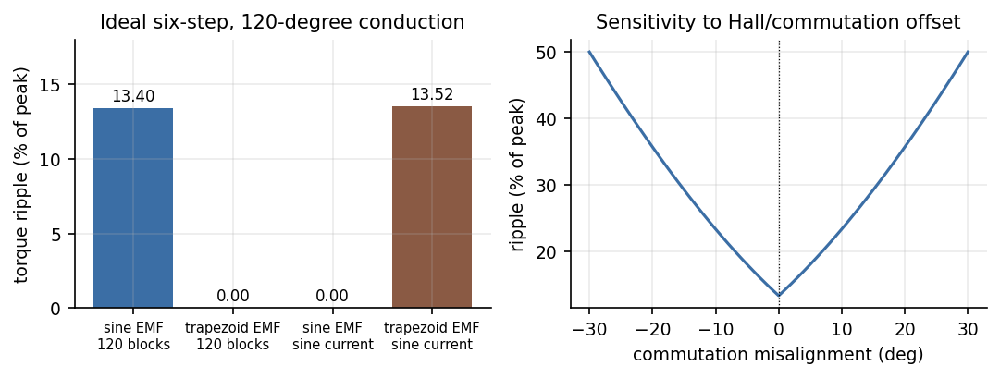

**Verdict.** C01 supported; C02 supported only for the ideal trapezoid. The practical lesson is to state the EMF shape and the alignment, not just the percentage.

### 4.2 E2 — SVPWM: 15.47% is headroom, not a waveform identity

The linear limit of sinusoidal PWM is \(V_{\rm phase,peak}/V_{\rm dc}=1/2\). Space-vector PWM reaches \(1/\sqrt{3}\). The ratio is

\[
\frac{1/\sqrt{3}}{1/2}-1 = \frac{2}{\sqrt{3}}-1 = 0.1547005384,
\]

or 15.4701%. The sampled limits are 0.500000 and 0.577350; the gain is 15.470054%, matching the analytic value.

The implementation identity is more useful than the percentage. SVPWM is SPWM plus the min-max zero sequence:

\[
u_0 = \tfrac{1}{2}\left(\max(u_a,u_b,u_c)+\min(u_a,u_b,u_c)\right).
\]

The line-line error between the two constructions is 2.22e-16 V, and the dwell-time construction agrees to 2.22e-16 V. At the test modulation index the maximum zero-sequence magnitude is 0.100.

The third-harmonic claim is where the compression bites. The exact min-max zero sequence contains a third harmonic of

\[
\frac{3\sqrt{3}}{8\pi} = 0.2067483358,
\]

and the sampled value is 0.206748. The “1/6 third harmonic” injection has a third harmonic of 0.166667. Both reach the same linear limit (0.577350), because the line-line fundamental is unchanged; they differ in common-mode voltage and therefore in bearing current, EMI, and leakage. At \(m=1\), the common-mode RMS of the exact min-max sequence is 0.1471, versus 0.1179 for the 1/6 injection, 20% lower. The identity “SVPWM = 1/6 third harmonic” is a qualified equivalence, not a definition.

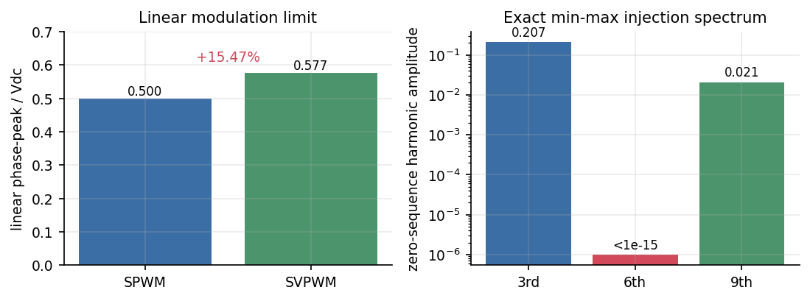

**Verdict.** C03 supported; C04 supported; C05 qualified.

### 4.3 E3 — Dead time: the formula is right, the average model is not enough

The dead-time experiment uses \(V_{\rm dc}=350\) V, \(f_1=50\) Hz, \(f_{\rm sw}=10\) kHz, \(t_d=800\) ns, \(L=5\) mH, \(R=0.5\) Ω, \(m=0.4\), eight fundamental cycles, and 200 ns steps. The base case gives a fundamental current of 84.18 A, a fifth harmonic of 0.1044 A (0.1241%), and a seventh harmonic of 0.0502 A (0.0597%). The fifth-to-seventh ratio is 2.079. The sixth harmonic in dq is 0.0837%.

The fundamental voltage error is 3.5685 V, against the analytic

\[
\Delta V = \frac{4}{\pi}\frac{t_d}{T_{\rm sw}}V_{\rm dc} = \frac{4}{\pi}(0.008)(350) = 3.5651\ \text{V},
\]

\(= 3.5651\) V. The difference is 0.10%. The average phase-voltage error is \(t_d f_{\rm sw} V_{\rm dc}=2.8\) V, which is the DC term that an average model would subtract.

The interesting result is the average model. It removes the fundamental error (0 V), but it does not remove the low-order current harmonics: the fifth is still 0.1129% and the seventh 0.0577%, close to the base case. The reason is that the dead-time error is not a constant DC voltage in the phase legs; it is a square wave at the fundamental frequency whose sign follows the phase current. Averaging it over a switching period produces a fundamental-frequency voltage, but the harmonic content seen by the current controller remains. A controller that compensates only the average error will reduce the fundamental distortion and leave the fifth/seventh current ripple.

The modulation sweep makes the normalization explicit. At \(m=0.1\) the fifth harmonic is 0.513%; at \(m=0.2\) it is 0.240%; at \(m=0.4\) it is 0.124%. The percentage is roughly inversely proportional to \(m\), because the fundamental current scales with \(m\) while the dead-time voltage error does not. A dead-time percentage quoted without a modulation index is not a property of the drive.

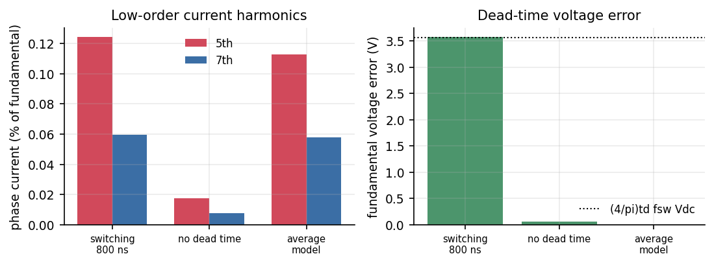

**Verdict.** C06 supported; C07 supported. The average-model result is a qualifier for any claim that “dead-time compensation removes the distortion”.

### 4.4 E4 — M/T speed measurement: the crossover is exact, the counts-per-revolution is not

The M method counts encoder pulses in a fixed gate time; the T method measures the period between edges. With \(N\) counts per revolution and a clock \(f_{\rm clk}\), the crossover is

\[
n^* = \frac{60}{N}\sqrt{\frac{f_{\rm clk}}{T_g}}.
\]

For \(N=1000\) lines and \(T_g=10\) ms, the crossover is 600.0 rpm at 1 MHz, 5,091.2 rpm at 72 MHz, and 8,818.2 rpm at 216 MHz. The one-count M resolution at 1 MHz is 6.0 rpm.

Table 2. Speed error at 1 MHz, \(N=1000\) lines, \(T_g=10\) ms.

| Speed (rpm) | M error (%) | T error (%) | M error (rpm) | T error (rpm) |
|---|---|---|---|---|
| 601 | 0.832 | 0.842 | 5.0 | 5.1 |
| 997 | 0.502 | 1.343 | 5.0 | 13.4 |
| 3,001 | 0.167 | 5.228 | 5.0 | 156.9 |
| 6,007 | 0.083 | 10.982 | 5.0 | 659.7 |
| 10,009 | 0.050 | 19.892 | 5.0 | 1,991.0 |

The crossover formula predicts the balance near 600 rpm: at 601 rpm the M error is 0.832% and the T error is 0.842%. Above it, T degrades as \(n^2\): at 6,007 rpm the T error is 659.7 rpm (10.98%), while M is 5.0 rpm (0.083%).

The hidden condition is \(N\). If “1000 lines” is read as 1000 counts per revolution, the numbers above hold. With a 4× quadrature decoder, \(N=4000\) and every crossover is four times lower (150.0 rpm at 1 MHz, 1,272.8 rpm at 72 MHz). A factor-of-four error in the decoder convention moves the recommended method by two octaves.

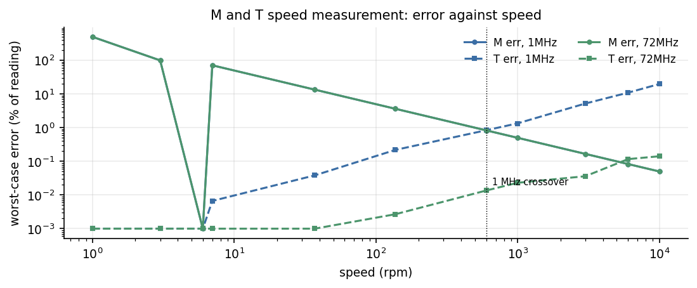

**Verdict.** C08 supported; C09 supported, with the counts-per-revolution convention stated.

### 4.5 E5 — K_t and K_e: the 15.47% is the same 2/√3

The ODrive D5065 270 Kv motor specifies K_v = 270 rpm/V line-line amplitude, seven pole pairs, and K_t = 0.031 Nm/A. The line-line back-EMF constant is

\[
K_e^{LL} = \frac{60}{2\pi K_v} = 0.0353677651\ \text{V}\cdot\text{s/rad},
\]

and the phase-peak constant is \(K_e^{LL}/\sqrt{3}=0.0204195887\). The flux linkage follows from the phase-peak EMF divided by the electrical angular frequency: \(\psi = K_e^{LL}/(\sqrt{3}p)\), where \(p=7\) is the pole-pair count. The stored value is \(\psi = 0.0029171\) Wb, or 2.9171 mWb.

The three K_t conventions are:

| Convention | Rule | K_t (Nm/A) | Ratio to FOC peak |
|---|---|---|---|
| DC / 120° | \(9.5493/K_v\) | 0.03537 | 1.15470 |
| FOC peak phase | \(8.2699/K_v\) | 0.03063 | 1 |
| RMS phase | \(11.6955/K_v\) | 0.04332 | 1.41421 |

The DC rule is 15.470% above the FOC peak rule; equivalently, the FOC value is 13.397% below the DC value. The factor is exactly \(2/\sqrt{3}=1.1547\), the same factor that appears in the SVPWM linear-limit gain. The datasheet’s 0.031 Nm/A is 1.210% above the FOC peak value, which is what one expects if the datasheet uses line-line peak voltage and peak phase current.

At 85 A the FOC convention gives 2.6035 Nm at 1000 rpm, with mechanical power 272.638 W and electrical power 272.638 W; the power balance residual is 2.22e-14%. At 45 A the torque is 1.3783 Nm.

The point is not that 9.5493 is “wrong”. It is that the sentence “K_t = 9.5493/K_v” is missing a subscript. The same motor has K_t = 0.03537, 0.03063, or 0.04332 Nm/A depending on whether the current is DC, peak phase, or RMS phase. The datasheet’s footnote is the convention witness; without it, the 1.21% agreement is a coincidence.

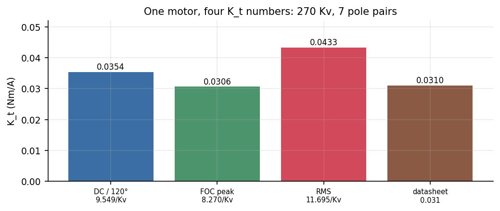

**Verdict.** C10 qualified: the DC rule is correct in its convention, not universal.

### 4.6 E6 — I2C pull-ups: 4.7 kΩ is a Standard-mode component

The I2C timing budget has two constraints. The minimum pull-up is set by the sink current:

\[
R_{p,\min} = \frac{V_{\rm DD}-V_{\rm OL}}{I_{\rm OL}},
\]

and the maximum by the rise time:

\[
R_{p,\max} = \frac{t_r}{0.8473\,C_b},
\]

where \(0.8473=\ln(7/3)\) is the exact coefficient for a 30–70% rise. The mode constants from UM10204 are: Standard 100 kHz, \(t_r=1000\) ns, \(C_b=400\) pF, \(I_{\rm OL}=3\) mA; Fast 400 kHz, \(t_r=300\) ns, \(C_b=400\) pF, \(I_{\rm OL}=3\) mA; Fast-mode Plus 1 MHz, \(t_r=120\) ns, \(C_b=550\) pF, \(I_{\rm OL}=20\) mA. \(V_{\rm OL}=0.4\) V in all three.

A 4.7 kΩ pull-up at 3.3 V supports at most 251.1 pF in Standard mode, 75.3 pF in Fast mode, and 30.1 pF in Fast-mode Plus. The ubiquitous 4.7 kΩ is therefore a Standard-mode part. At 100 pF it is fine in Standard mode, marginal-to-invalid in Fast mode (the maximum capacitance is below 100 pF), and invalid in FM+.

Table 3. I2C pull-up windows at 3.3 V. A window is feasible when \(R_{p,\min}\le R_{p,\max}\).

| Case | \(R_{p,\min}\) (Ω) | \(R_{p,\max}\) (Ω) | Margin (Ω) | Feasible |
|---|---|---|---|---|
| Standard, 400 pF | 966.7 | 2,950.6 | 1,983.9 | yes |
| Fast, 400 pF | 966.7 | 885.2 | -81.5 | no |
| FM+, 550 pF, 20 mA | 145.0 | 257.5 | 112.5 | yes |
| FM+, 550 pF, 3 mA | 966.7 | 257.5 | -709.2 | no |

The Fast-mode 400 pF case is empty: 966.7 Ω minimum is above 885.2 Ω maximum. This is not a matter of choosing a different resistor; the timing and sink-current specifications cannot both be met at 3.3 V. The FM+ case is feasible with the correct 20 mA sink, with a window of 145–258 Ω. Reusing the 3 mA sink from Standard/Fast gives a false impossibility: the minimum becomes 967 Ω and the margin is -709 Ω. The formula did not change; the current convention did.

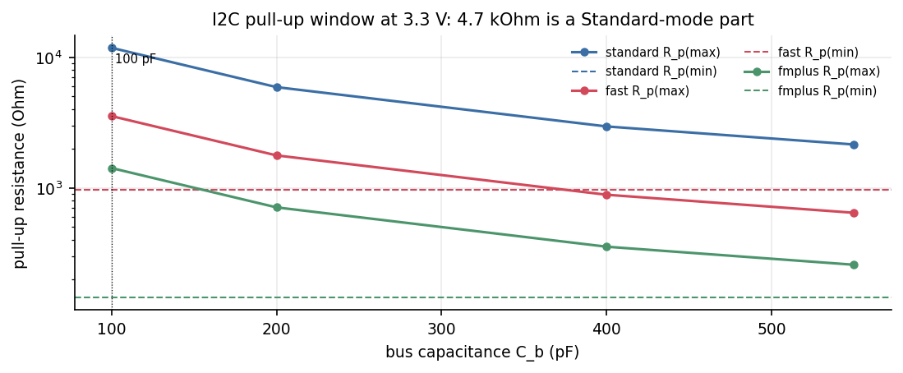

**Verdict.** C11 refuted; C12 refuted; C13 refuted. The general lesson is that a pull-up value is meaningless without the mode, the bus capacitance, and the sink current.

### 4.7 E7 — RS-485: the 680 Ω bias passes unloaded and fails loaded

A failsafe-biased RS-485 bus must keep \(|V_{AB}|\ge 200\) mV when no driver is active. The bias network is a divider between \(V_{\rm DD}\) and ground, loaded by the termination and by the input resistance of every receiver. A 32-unit-load node is 32 × 12 kΩ = 375 Ω in parallel with the termination.

The maximum bias resistor for 200 mV is:

| \(V_{\rm DD}\) | Termination | Load | \(R_{\rm bias,max}\) (Ω) |
|---|---|---|---|
| 3.3 V | 60 Ω | none | 465.0 |
| 3.3 V | 60 Ω | 32 UL | 400.9 |
| 3.3 V | 120 Ω | none | 930.0 |
| 3.3 V | 120 Ω | 32 UL | 704.5 |
| 5 V | 60 Ω | none | 720.0 |
| 5 V | 60 Ω | 32 UL | 620.7 |
| 5 V | 120 Ω | none | 1,440.0 |
| 5 V | 120 Ω | 32 UL | 1,090.9 |

The common 680 Ω bias at 5 V is the clearest case. Unloaded, it gives 0.2113 V = 211.3 mV, which passes. With 32 unit loads it gives 183.2 mV, which fails. A 560 Ω bias gives 220.7 mV and passes. At 3.3 V, 430 Ω gives 187.2 mV (fails) and 390 Ω gives 205.2 mV (passes).

The 680 Ω value is not a random error. It is the value that passes the unloaded calculation, which is the calculation a designer does when the schematic shows two terminators and no receivers. The 32-unit-load condition is the hidden variable. This is the cleanest example in the corpus of a claim that is true on the bench and false in the field.

Termination is a second convention trap. RS-485 is specified around 120 Ω, but Cat5e is about 100 Ω. A 120 Ω termination on 100 Ω cable gives a reflection coefficient of 9.09% and a return loss of 20.83 dB; a 150 Ω termination gives \(\Gamma=-11.11\)% and 19.08 dB. The 120 Ω is the driver/receiver nominal, not a cable match. For short drops the mismatch is tolerable; for long buses at high data rates it is not.

The DE timing table is a third hidden condition. An 8E1 frame is 11 bits. At 9600 baud a byte is 1,145.8 µs and the worst-case write-to-TC interval is 2,291.7 µs; at 115200 baud the byte is 95.5 µs; at 921600 baud it is 11.9 µs. A fixed 10 µs DE hold is generous at 9600 and marginal at 921600.

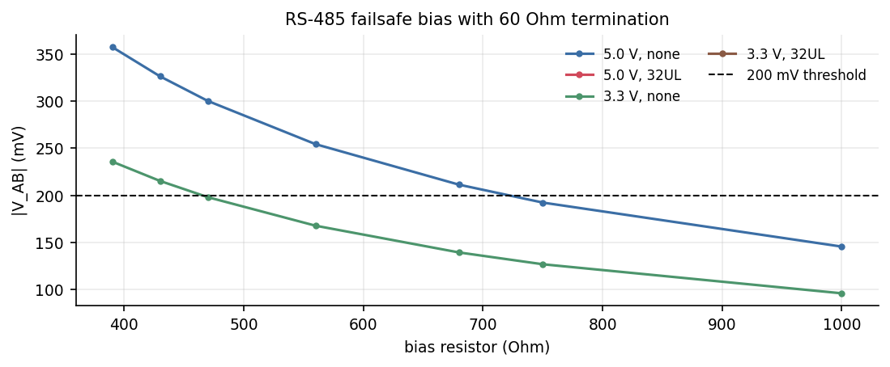

**Verdict.** C14 refuted for a loaded bus; C15 qualified: 120 Ω is the RS-485 nominal, not a Cat5e match.

### 4.8 E8 — PCB traces: IPC-2221 is not conservative at high current

IPC-2221 gives

\[
I = k\,\Delta T^{0.44} A^{0.725},
\]

with \(k=0.048\) for external layers and \(k=0.024\) for internal layers (1 oz copper). At 10 A, 10 °C rise, 1 oz, the external width is 7.19 mm and the internal width is 18.71 mm. The area ratio is exactly

\[
\left(\frac{0.048}{0.024}\right)^{1/0.725} = 2^{1/0.725} = 2.6014,
\]

which matches the stored 2.6014. This is an arithmetic artifact: halving \(k\) is equivalent to halving the current for the same area. The “2.6× penalty” is not an independent measurement of internal-layer thermal performance.

The IPC-2152 empirical fit (Brooks–Adam) is

\[
\Delta T = K\,I^a W^b Th^c,
\]

with widths and thickness in mils. The external fit uses \(K=215.3\), \(a=2\), \(b=-1.15\), \(c=-1.0\); the internal fit uses \(K=200\), \(a=1.9\), \(b=-1.10\), \(c=-1.52\). At the same 10 A/10 °C/1 oz point, the external fit is 15.21 mm and the internal fit is 13.26 mm. The external fit is 2.114× the IPC-2221 width; a 2026 chart reading is 18.7 mm, or 2.599×.

Table 4. 50 mm trace at 10 A, 10 °C, 1 oz.

| Case | Width (mm) | R (mΩ) | Drop at 10 A (mV) | Loss at 10 A (W) |
|---|---|---|---|---|
| IPC-2221 external | 7.19 | 3.416 | 34.16 | 0.3416 |
| IPC-2152 fit external | 15.21 | 1.616 | 16.16 | 0.1616 |
| IPC-2152 chart external | 18.7 | 1.314 | 13.14 | 0.1314 |
| IPC-2221 internal | 18.71 | 1.313 | 13.13 | 0.1313 |
| IPC-2152 fit internal | 13.26 | 1.853 | 18.53 | 0.1853 |

The table has two surprises. First, IPC-2221 external is 3.42 mΩ for 50 mm, while the IPC-2152 chart external is 1.31 mΩ; the width difference is a factor of 2.6, so the resistance and loss differ by the same factor. Second, the IPC-2221 internal width (18.7 mm) is close to the IPC-2152 chart external width (18.7 mm), but for different reasons: IPC-2221 halved the current, while IPC-2152 used an internal-layer fit. The coincidence is a good reminder that two numbers can agree while their derivations do not.

The fit and the chart differ by about 23% (15.21 mm versus 18.7 mm). The chart reading is a digitization; the fit is an empirical correlation. Both are approximations, and the paper reports both rather than choosing one. The robust conclusion is qualitative: at 10 A and 10 °C, IPC-2221’s external width is too small, and the internal “2.6×” is not a measured penalty.

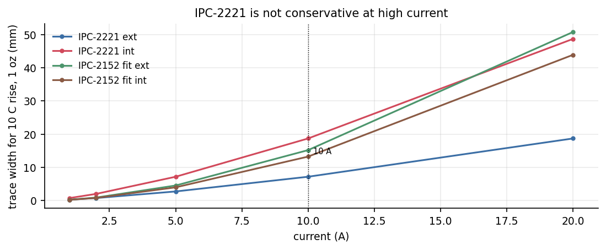

**Verdict.** C16 refuted: IPC-2221 is not conservative at high current. C17 qualified: the 2.6× is arithmetic, not an independent thermal measurement.

### 4.9 E9 — Unipolar PWM: ripple and loss are different “halves”

The H-bridge experiment uses \(V_{\rm dc}=48\) V, \(f_1=100\) Hz, \(f_{\rm sw}=20\) kHz, \(L=5\) mH, \(R=2\) Ω, \(i_0=5\) A, \(m=0.6\), four fundamental periods, and 2,000 steps per switching period. Four schemes are compared:

- **Bipolar**: both legs switch complementarily; the output is \(+V_{\rm dc}\) or \(-V_{\rm dc}\).
- **Unipolar, single-leg**: one leg switches at \(f_{\rm sw}\), the other holds; the output is \(+V_{\rm dc}\) or 0.
- **Unipolar, dual-leg aligned**: both legs switch at \(f_{\rm sw}\), aligned; the output is \(+V_{\rm dc}\), 0, or \(-V_{\rm dc}\), with the zero state used for the off-time.
- **Unipolar, dual-leg phase-shifted**: both legs switch at \(f_{\rm sw}\), shifted by half a period; the output is a three-level waveform with a negative segment at \(m=0.6\).

Table 5. Ripple and loss at \(m=0.6\).

| Scheme | Ripple p-p (A) | Ratio to bipolar | Negative-voltage fraction | Transitions per \(T_{\rm sw}\) | Loss proxy |
|---|---|---|---|---|---|
| Bipolar | 0.1540 | 1.000 | 0.200 | 4.0 | 1.000 |
| Unipolar single-leg | 0.1155 | 0.750 | 0 | 2.0 | 0.500 |
| Dual-leg aligned | 0.0580 | 0.376 | 0 | 4.0 | 1.000 |
| Dual-leg shifted | 0.1540 | 1.000 | 0.200 | 4.0 | 1.000 |

The analytic values are close: bipolar 0.1536 A, single-leg 0.1152 A, dual-leg aligned 0.0576 A. The single-leg ratio is 0.750, which is \(2m/(1+m)\) at \(m=0.6\). The dual-leg aligned ratio is 0.375, which is \(m/(1+m)\).

The claim “unipolar halves ripple” is true only for the dual-leg aligned scheme, and only because it uses the zero state to reduce the volt-second ripple. It is false for the single-leg scheme, where the ratio is 0.750 at \(m=0.6\) and approaches 1 as \(m\to 1\). It is also false for the naive dual-leg phase-shifted scheme, where the phase shift produces a negative-voltage segment: the negative-voltage fraction is 0.200 and the ripple ratio is 1.000.

The loss claim is the mirror image. The single-leg scheme has two transitions per switching period instead of four, so its loss proxy is 0.500. The dual-leg aligned scheme has four transitions and a loss proxy of 1.000 — it halves ripple but not loss. Thus “unipolar halves ripple” and “unipolar halves loss” are both half-truths, and they are true for different schemes.

The modulation sweep makes the asymptote explicit. At \(m=0.2\) the single-leg ratio is 0.333; at \(m=0.4\) it is 0.571; at \(m=0.6\) it is 0.750; at \(m=0.8\) it is 0.889; at \(m=0.9\) it is 0.947. The “0.5” is the \(m\to0\) limit of \(2m/(1+m)\), not a general result.

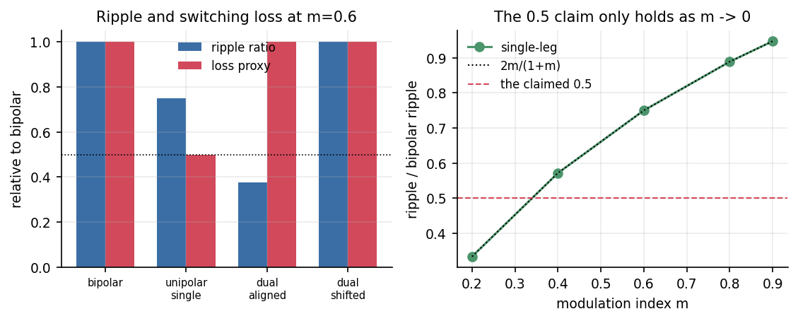

**Verdict.** C18 qualified; C19 supported only for the single-leg scheme.

### 4.10 E10 — Real data: a real torque channel is not necessarily an independent torque measurement

The Paderborn dataset contains 1,330,816 rows from 69 profiles, 184.84 hours at 2.0 Hz, licensed CC BY-SA 4.0. The file is 78f3d150f0f2ad9c5dc7ff24dd12c00d386ad530f48c1589ad24fcd88867d3ad (SHA-256). The high-load subset (\(|i_q|>50\) A, \(|T|>20\) Nm, \(|n|>500\) rpm) has 628,045 rows; the motoring subset (\(i_q>50\) A, \(T>20\) Nm, \(n>500\) rpm) has 472,226 rows.

Table 6. Torque and voltage regressions on the high-load subset.

| Fit | Basis | Coefficient | \(R^2\) | RMSE |
|---|---|---|---|---|
| Torque, high-load | \(i_q\) | 0.71639 | 0.999015 | 2.9879 |
| Torque, high-load | \(i_q \Delta T_{\rm pm}\) | 1.588e-04 | | |
| Torque, high-load | \(i_d i_q\) | -0.001080 | | |
| Torque, motoring | \(i_q\) | 0.74496 | 0.997916 | 1.9429 |
| \(u_q\) | \(i_q\) | 0.022946 | 0.995818 | 1.8989 |
| \(u_q\) | \(\omega\) | 0.449054 | | |
| \(u_q\) | \(\omega \Delta T_{\rm pm}\) | -5.480e-04 | | |
| \(u_d\) | \(i_d\) | 0.040784 | 0.994841 | 5.9706 |

The q-axis voltage fit gives \(R=0.02295\) Ω, a copper coefficient of 0.461%/K, a magnet coefficient of -0.122%/K, \(k_d=0.00194\) H, and \(k_f=0.44905\) V·s/rad. The d-axis fit gives \(R=0.04078\) Ω, a copper coefficient of 0.116%/K, and \(k_q=0.00296\) H. The two resistance estimates differ (22.9 mΩ versus 40.8 mΩ) because the d-axis regressor is correlated with the cross-coupling term and the d-axis current is smaller in the high-load subset; the q-axis channel is the cleaner estimate.

The torque high-load slope is 0.7164 Nm/A and the motoring slope is 0.7450 Nm/A; the difference is absorbed by the reluctance term and the operating range. The torque temperature coefficient is 0.0222%/K high-load and -0.0329%/K motoring, while the q-axis back-EMF coefficient is -0.1220%/K. A direct torque measurement of a PMSM should show the magnet temperature coefficient, because \(T\propto \psi i_q\) (plus reluctance); the torque channel does not. It is nearly flat. The dataset description says the torque is derived from the set currents and voltages; the data are consistent with a fixed-parameter torque model. A real dataset can be real and still not validate what it appears to validate.

The voltage-derived torque law is \(1.5[k_f i_q+(k_d-k_q)i_d i_q]\). It predicts the measured torque with a scale of 1.001401, an offset of -0.1236 Nm, \(R^2=0.998235\), and RMSE 4.0001 Nm. The scale is within 0.14% of unity. The torque law from the voltage channel and the torque channel agree because they are built from the same currents and voltages, not because the torque sensor is independent.

The power balance tests the dq convention. With the 1.5 factor, the median \(P_{\rm elec}/P_{\rm mech}\) is 1.0535, the mean is 1.0582, and the 5th–95th percentile range is 1.0080–1.1172. The median efficiency is 0.9492. Without the 1.5 factor, the median is 0.7023, corresponding to an apparent efficiency of 1.4238 (142%). The 1.5 factor is not an arbitrary convention; the data reject the alternative.

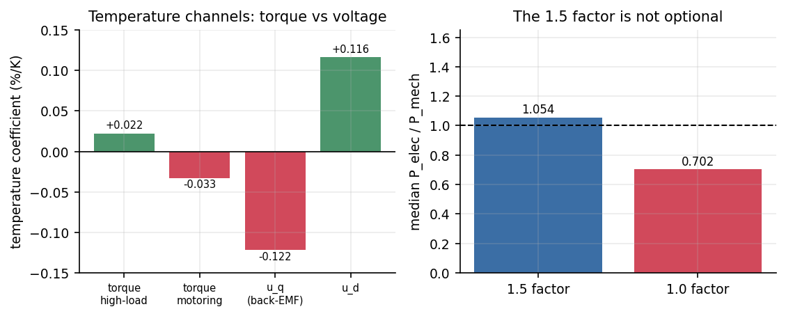

**Verdict.** C20 refuted: the torque channel is not independent. C21 refuted: the 1.5 factor is fixed by the data. C22 supported: the magnet coefficient is -0.122%/K, inside the NdFeB range.

---

## 5. Cross-cutting patterns

The ten experiments are different, but the failures are not. Five patterns account for every qualified or refuted claim in Table 1.

**5.1 Normalization.** The same physical ripple is 13.4% of peak and 14.0% of mean (E1). The same K_t is 0.03537, 0.03063, or 0.04332 Nm/A depending on the current convention (E5). A dead-time percentage is inversely proportional to the modulation index (E3). The number is not the quantity; the denominator is part of the quantity.

**5.2 Convention.** The 4.7 kΩ pull-up is a Standard-mode component (E6). The 3 mA sink current is a Standard/Fast specification, not an FM+ specification; using it for FM+ manufactures a false impossibility (E6). The IPC-2221 internal-layer coefficient is a halved current, not a measured penalty (E8). The K_t formula is a convention, not a law (E5).

**5.3 Hidden loading.** The 680 Ω RS-485 bias passes unloaded and fails with 32 unit loads (E7). The 4.7 kΩ pull-up passes at 100 pF in Standard mode and fails in Fast mode (E6). The IPC-2221 table assumes 1 oz copper and a 10 °C rise; a different copper thickness or temperature changes the answer (E8). The load is often the difference between a bench demo and a product.

**5.4 Model-derived data.** The Paderborn torque channel is real data, but it behaves like a fixed-parameter model: nearly temperature-flat torque, temperature-sensitive voltage (E10). A dataset can be large, public, and licensed, and still not contain the independent variable its name suggests. Provenance is part of the evidence.

**5.5 Arithmetic artifacts and asymptotes.** The IPC-2221 2.6× is exactly \(2^{1/0.725}\) (E8). The SVPWM 15.47% is exactly \(2/\sqrt{3}-1\), the same factor that separates DC and FOC K_t (E2, E5). The “unipolar halves ripple” claim is the \(m\to0\) limit of \(2m/(1+m)\), not a general result (E9). An identity can be exact and still be misread as a measurement; an asymptote can be exact and still be misread as a general rule.

Table 7. The patterns and their remedies.

| Pattern | Examples | Consequence | Remedy |
|---|---|---|---|
| Normalization | 13.4% vs 14.0%; K_t 0.03537 vs 0.03063 | The number is right, the comparison is wrong | State the denominator and the current convention |
| Convention | 9.55/K_v vs 8.27/K_v; 3 mA vs 20 mA; IPC k=0.048 vs 0.024 | A formula is applied outside its home | State the mode, the layer, and the unit system |
| Hidden loading | 680 Ω unloaded vs 32 UL; 4.7 kΩ at 100 pF; 1 oz/10 °C | Bench pass, field fail | State the load, the capacitance, and the copper |
| Model-derived data | Paderborn torque | A real dataset validates the wrong thing | Report provenance and test the channel’s temperature dependence |
| Arithmetic artifact | IPC 2.6×; SVPWM 15.47%; unipolar 0.5 | An identity is mistaken for a measurement | Derive the factor; distinguish identity from asymptote |

The practical checklist is short. Before quoting a number, ask: *normalized to what, in which convention, under what load, from which channel, and is it an identity or an asymptote?* The checklist is more valuable than any single corrected constant in this paper.

---

## 6. Threats to validity

**Construct validity.** The claim set is purposive, not random. The corpus is educational, not a specification; a creator may have stated the qualifier in a part of the video that was not transcribed. The verdicts apply to the claims as extracted. The extraction was done by one reader, and a second reader could draw the boundaries differently.

**Internal validity.** The simulations are ideal-switch models. E3 ignores device nonlinearity, gate-driver delay mismatch, parasitic inductance, and temperature-dependent dead time. E9 ignores diode reverse recovery and uses a loss proxy (transitions per switching period) rather than a calibrated switching-energy model. The E10 regressions are descriptive OLS fits; the regressors are correlated, the residuals are autocorrelated in time, and the reported \(R^2\) is optimistic as a measure of predictive skill. The torque-provenance conclusion is abductive: the near-flat torque coefficient is consistent with a model-derived channel, but it does not prove the derivation.

**External validity.** The datasheet values are nominal. The Paderborn machine is one anonymized prototype, and its operating range is not the full space of PMSM drives. The IPC-2152 fit is an empirical correlation, and the chart reading is a digitization; the 23% difference between the fit and the chart is a real uncertainty, not a rounding error. The RS-485 unit-load model assumes nominal 12 kΩ receivers and does not include stub reflections or common-mode shifts.

**Conclusion validity.** “Supported” is conditional on the stated operating point. The paper does not claim that a supported formula is universally true, or that a refuted claim is useless. The 680 Ω bias is a reasonable starting point for a short, lightly loaded bus; the 4.7 kΩ pull-up is a reasonable starting point for a 100 kHz bus. The audit’s claim is that the omitted condition is part of the engineering claim.

**Statistical validity.** The E10 coefficients are reported without confidence intervals because the residuals are not independent. The sample size is large, so the standard errors would be small even if the model is misspecified. The paper therefore emphasizes effect sizes and qualitative consistency (torque versus voltage temperature coefficients) rather than p-values.

---

## 7. Reproducibility and artifact evaluation

### 7.1 Commands

```bash
make all        # run E1-E10, render figures, render README.md, verify
make experiments
make paper
make verify
make test
make lint
make docker     # build the container
make docker-run # run the full pipeline in the container
```

`make all` runs the experiments, renders the figures and this document, and then re-runs the experiments for verification. The verification compares the stored and fresh payloads; a mismatch exits non-zero. The paper target depends on the experiments, so a stale result cannot silently survive a rebuild.

### 7.2 Data

The Paderborn CSV is not redistributed. `scripts/download_data.py` prints the Kaggle command and the expected SHA-256:

```bash
kaggle datasets download -d wkirgsn/electric-motor-temperature -p data/raw --unzip
```

The expected SHA-256 of `data/raw/measures_v2.csv` is `78f3d150f0f2ad9c5dc7ff24dd12c00d386ad530f48c1589ad24fcd88867d3ad`. The dataset is CC BY-SA 4.0. If the file is absent, E10 returns `status: "data_missing"`, `verify` reports E10 as skipped, and E1–E9 still run. This is deliberate: the artifact should be usable without a 300 MB download and a Kaggle account.

### 7.3 Environment

The reference environment is Python 3.12, NumPy 2.2, SciPy 1.13, pandas 2.2, matplotlib 3.8, PyYAML 6.0, and Jinja2 3.1. `results/results.json` records the exact versions and platform for each run. The Dockerfile pins the base image and installs the requirements; the Compose service mounts the repository and runs the same `make` targets.

### 7.4 ACM artifact badging

The artifact is designed for the ACM “Artifacts Evaluated — Functional” and “Artifacts Evaluated — Reusable” badges, and for “Results Reproduced” by an independent evaluator:

- **Documented**: this paper, the README, the claim registry, and the module docstrings.
- **Consistent**: one artifact format, one claim path per number, one verification command.
- **Complete**: all ten experiments, all figures, all claims, and the data-download path.
- **Exercisable**: `make all` from a clean checkout; `make verify` for the comparison.
- **Reusable**: MIT license for the code, CC BY-SA 4.0 for the data, pinned dependencies, Docker.
- **Results reproduced**: `make verify` re-runs the experiments and compares the payloads; the paper’s numbers are resolved from the same JSON.

The one honest gap is hardware. The artifact reproduces the *calculations and the data analysis*, not a bench measurement. The paper says so rather than claiming a hardware reproduction it did not perform.

---

## 8. Conclusion

The corpus’s formulas are mostly right. The failures are in the qualifiers. A 120-degree six-step drive has 13.4% ripple if the EMF is sinusoidal and the commutation is aligned; a K_t of 9.5493/K_v is correct if the current is DC and the EMF is line-line; a 4.7 kΩ pull-up is fine if the bus is Standard mode, short, and lightly loaded; a 680 Ω bias is fine if no receivers are connected; IPC-2221 is conservative if the current is low; unipolar PWM halves ripple if “unipolar” means the dual-leg aligned scheme, and halves loss if it means the single-leg scheme. The number is the visible part of the claim; the condition is the part that travels.

The audit’s methodological contribution is the claim tuple: formula, convention, operating point, hidden load, and evidence class. The tuple is what a reproducible artifact should store. The ten experiments are one instance of the tuple; the pattern generalizes to other compressed engineering claims.

Future work has three directions. First, hardware-in-the-loop: measure the dead-time harmonics and the H-bridge ripple on a bench, and compare the ideal-switch predictions with the measurements. Second, a larger corpus: automate claim extraction from transcripts and build a registry across more creators and more topics. Third, a public benchmark: a set of claims with executable oracles, so that an educator can check a new slide against the same standard.

The most useful sentence in the corpus may be the one that says “it depends”. This paper’s job is to say what it depends on.

---

## Appendix A. Derivations

### A.1 Six-step ripple

With ideal 120-degree conduction and a sinusoidal EMF, the torque is the sum of two phase products. Normalizing by the peak torque gives \(1-\sqrt{3}/2\). Normalizing by the mean gives \(\pi(\sqrt{3}-3/2)/(3\sqrt{3})\). The two numbers differ because the mean is not the peak; the identity is exact, and the sampled construction reproduces it to \(2.49e-14\).

### A.2 SVPWM

The min-max zero sequence is \(u_0=\tfrac12(\max u+\min u)\). Adding it to the phase references preserves the line-line voltages and centers the waveform in the dc bus. The linear limit is \(1/\sqrt{3}\), hence the \(2/\sqrt{3}-1\) gain. The third harmonic of the exact min-max sequence is \(3\sqrt{3}/(8\pi)\); the 1/6 injection is a different sequence with the same line-line fundamental and a different common-mode RMS.

### A.3 Dead time

The average error per switching period is \(t_d f_{\rm sw}V_{\rm dc}\). The fundamental component of the square-wave error is \((4/\pi)t_d f_{\rm sw}V_{\rm dc}\). The fifth and seventh phase-current harmonics scale as \(1/h^2\) for a voltage harmonic \(1/h\), giving the observed 2:1 ratio; in dq both map to the sixth harmonic.

### A.4 M/T

The M method has a one-count resolution \(60/(N T_g)\). The T method has a period error that grows as \(n^2 N/(60 f_{\rm clk})\). Equating them gives the crossover \(n^*=(60/N)\sqrt{f_{\rm clk}/T_g}\). The counts-per-revolution convention (lines versus quadrature counts) scales \(N\) and moves the crossover by the same factor.

### A.5 K_t and K_e

\(K_e^{LL}=60/(2\pi K_v)\). The DC/120-degree convention sets \(K_t=K_e^{LL}\). The FOC peak-phase convention sets \(K_t=(3/2)K_e^{\rm phase,peak}=(3/2)(K_e^{LL}/\sqrt{3})=(\sqrt{3}/2)K_e^{LL}\). The RMS convention multiplies by \(\sqrt{2}\). The ratio between the DC and FOC values is \(2/\sqrt{3}\).

### A.6 I2C

\(R_{p,\min}=(V_{\rm DD}-V_{\rm OL})/I_{\rm OL}\). \(R_{p,\max}=t_r/(0.8473 C_b)\), with \(0.8473=\ln(7/3)\) for the 30–70% rise time. The window is feasible when the minimum is below the maximum.

### A.7 RS-485

The bias divider is loaded by the parallel combination of the termination and the receiver input resistances. The differential voltage is \(V_{AB}=V_{\rm DD}R_{\rm eq}/(R_{\rm bias}+R_{\rm eq})\), where \(R_{\rm eq}\) includes the two bias resistors and the load. The reflection coefficient is \(\Gamma=(Z_L-Z_0)/(Z_L+Z_0)\).

### A.8 IPC

IPC-2221: \(I=k\Delta T^{0.44}A^{0.725}\). The internal/external area ratio at fixed current and temperature is \((0.048/0.024)^{1/0.725}=2.6014\). IPC-2152: \(\Delta T=K I^a W^b Th^c\) with the fitted constants in Section 4.8.

### A.9 H-bridge

For bipolar PWM the ripple is \(V_{\rm dc}(1-m^2)/(4Lf_{\rm sw})\); for single-leg unipolar it is \(V_{\rm dc}(1-m)m/(2Lf_{\rm sw})\); for dual-leg aligned it is half the single-leg value. The ratio single/bipolar is \(2m/(1+m)\); the ratio dual-aligned/bipolar is \(m/(1+m)\).

### A.10 Paderborn fits

The torque fit uses \(i_q\), \(i_q\Delta T_{\rm pm}\), \(i_d i_q\), \(i_d\), and a constant; the voltage fits use the q- and d-axis equations with \(i_q\), temperature-weighted \(i_q\), \(\omega i_d\), \(\omega\), \(\omega\Delta T_{\rm pm}\), and a constant. The power balance uses \(P_{\rm elec}=1.5(u_d i_d+u_q i_q)\) and \(P_{\rm mech}=T\omega\). The factor 1.5 is the amplitude-invariant dq convention; without it the apparent efficiency exceeds unity.

---

## Data and code availability

The code is in this repository under the MIT license. The Paderborn dataset is available from Kaggle (`wkirgsn/electric-motor-temperature`) under CC BY-SA 4.0; it is not redistributed here. The claim registry is `claims/claims.yaml`; the combined results are `results/results.json`; the figures are `results/figures/`.

## Competing interests

The authors declare no competing interests. The audit is independent of the corpus creators and of the vendors whose datasheets are cited.

## References

1. ODrive Robotics. *Motors* (ODrive D5065 270KV datasheet). https://docs.odriverobotics.com/v/latest/hardware/odrive-motors.html (accessed 2026).
2. NXP Semiconductors. *UM10204: I²C-bus specification and user manual*, Rev. 6, 2021. https://www.nxp.com/docs/en/user-guide/UM10204.pdf
3. Texas Instruments. *SLVA689A: I²C Bus Pullup Resistor Calculation*, 2015. https://www.ti.com/lit/an/slva689a/slva689a.pdf
4. Texas Instruments. *SLLA070D: RS-485 & RS-422 Design Guide*. https://www.ti.com/lit/pdf/slla070
5. STMicroelectronics. *RM0410: Reference manual, STM32F76xxx and STM32F77xxx advanced Arm-based 32-bit MCUs*.
6. IPC. *IPC-2221B: Generic Standard on Printed Board Design*, 2012.
7. IPC. *IPC-2152: Standard for Determining Current-Carrying Capacity in Printed Board Design*, 2009.
8. Association for Computing Machinery. *Artifact Review and Badging — Version 1.1*, 2020. https://www.acm.org/publications/policies/artifact-review-and-badging-current/
9. W. Kirchgässner, O. Wallscheid, and J. Böcker. “Estimating Electric Motor Temperatures with Deep Residual Machine Learning.” *IEEE Transactions on Power Electronics*, 36(7), 2021.
10. Kaggle. *Electric Motor Temperature* (Paderborn LEA PMSM dataset). https://www.kaggle.com/datasets/wkirgsn/electric-motor-temperature
11. Cadence. “IPC-2152 vs IPC-2221: Which to Use for PCB Thermal Analysis?” https://resources.system-analysis.cadence.com/blog/ipc-2152-vs-ipc-2221-which-to-use-for-pcb-thermal-analysis
12. rftools. “PCB Trace Width Current Capacity.” https://rftools.io/blog/pcb-trace-width-current-capacity/
13. P. C. Krause, O. Wasynczuk, S. D. Sudhoff, and S. Pekarek. *Analysis of Electric Machinery and Drive Systems*, 3rd ed., Wiley, 2013.
14. D. G. Holmes and T. A. Lipo. *Pulse Width Modulation for Power Converters: Principles and Practice*, Wiley-IEEE, 2003.
15. R. W. Erickson and D. Maksimović. *Fundamentals of Power Electronics*, 3rd ed., Springer, 2020.
16. J. Pyrhönen, T. Jokinen, and V. Hrabovcová. *Design of Rotating Electrical Machines*, 2nd ed., Wiley, 2014.